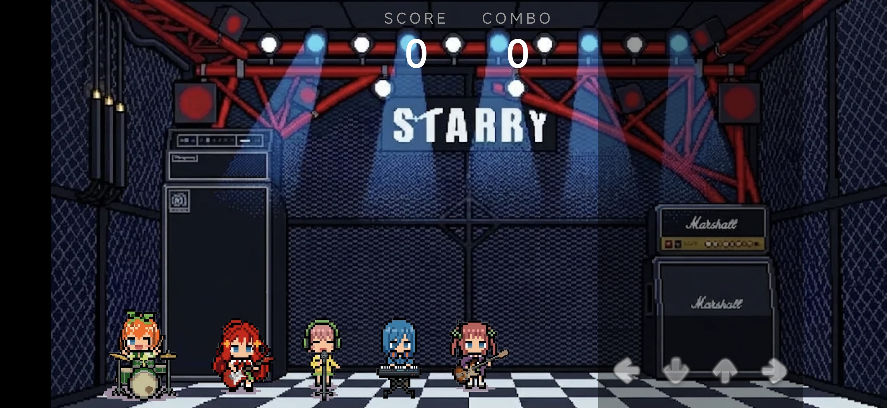

🎵 Quintuples Beat

  

<h3 align="center">🎤 Cinco gêmeas, uma banda e um só ritmo!</h3>

  Quintuples Beat é um jogo sobre cinco irmãs gêmeas que decidiram se unir para formar uma banda e compartilhar sua paixão pela música.

  <a href="https://gemeas-game.vercel.app/"><strong>▶ JOGAR AGORA</strong></a>

---

🎮 Sobre o jogo

Cinco irmãs gêmeas decidem unir seus talentos e formar uma banda. Assim nasce o Quintuples Beat, um jogo que reúne música, diversão e personagens em uma experiência interativa.

🕹️ Gameplay

  

  <em>Clique na imagem para acessar o jogo!</em>

---

👥 Equipe de desenvolvimento

O projeto foi desenvolvido por uma equipe de cinco integrantes:

- Carlos Eduardo Santos Silva
- Fillipi Gabriel Bezerra de Lima
- José Eduardo de Almeida Araújo
- Marcelo Henrique Vieira de Sousa
- Yan Victor Araújo Freire
🎸
---

🚀 Acesse o projeto

  <a href="https://gemeas-game.vercel.app/">
    <strong>Quintuples Beat — Jogar no Vercel</strong>
  </a>

  🎶 <strong>Quintuples Beat</strong>
   
  Cinco gêmeas. Uma banda. Um só ritmo!

